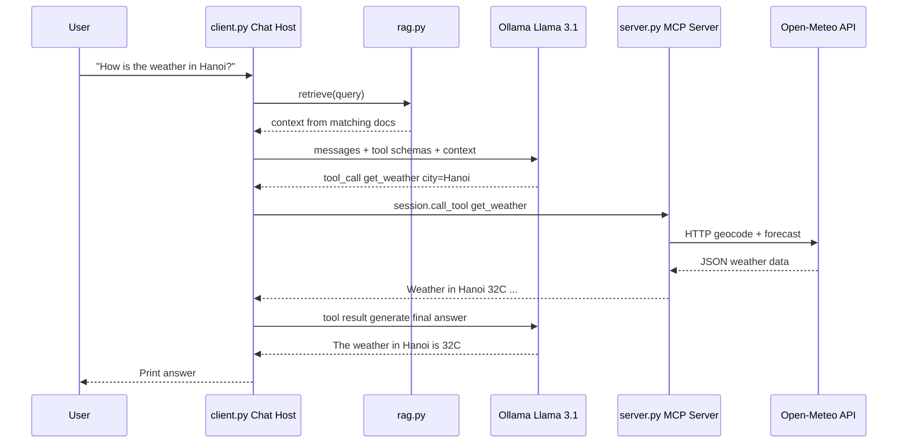

# MCP Learning Project

A minimal, educational project that demonstrates how the **Model Context Protocol (MCP)** works end-to-end. It connects a local Llama 3.1 LLM (via Ollama) to an MCP tool server, with simple file-based RAG for knowledge grounding.

> **Goal:** Learn the MCP architecture by tracing every step — from user input, through the LLM, to tool execution and back.

---

## Architecture



### How the pieces fit together

| Component | Role | File |
|-----------|------|------|
| **Host** | The user-facing application — our CLI chat loop | `client.py` |
| **Client** | MCP protocol connector (`ClientSession`) that manages a 1:1 session with the server | Inside `client.py` |
| **Server** | Exposes tools, resources, and prompts over MCP | `server.py` |
| **Tool** | A callable function the LLM can invoke (e.g. `create_file`, `get_weather`, `crawl_webpage`) | Defined in `server.py` |
| **Resource** | Read-only data the server exposes (like a GET endpoint) — `docs://list` | `server.py` (optional) |
| **Prompt** | A reusable message template — `summarize_file` | `server.py` (optional) |
| **Transport** | stdio — client launches server as subprocess, talks through stdin/stdout | Configured in `client.py` |
| **RAG** | Loads text files and injects relevant ones into the LLM system prompt | `rag.py` |

---

## How to run

### 1. Install Ollama

Download from [ollama.com](https://ollama.com/) and install it. Then pull the model:

```bash
ollama pull llama3.1
```

> **Why `llama3.1`?** Plain `llama3` has weak/no native tool-calling support in Ollama. `llama3.1` was trained with tool-calling capabilities, so the LLM can return structured `tool_calls` instead of just text.

Verify it works:

```bash
ollama run llama3.1 "Say hello in one sentence."
```

### 2. Set up the Python environment and run

```bash
cd mcp-learning

# Create and activate a virtual environment
python -m venv .venv
# Windows:
.venv\Scripts\activate
# Linux/Mac:
# source .venv/bin/activate

# Install dependencies
pip install -r requirements.txt

# Start the chat (launches the MCP server automatically)
python client.py

# Or run without debug output:
# python client.py --quiet
```

You will see debug output showing every step of the flow:

```
  [MCP] Launching server: python server.py
  [MCP] Session initialised
  [MCP] Connected — 4 tools available: create_file, get_weather, list_files, read_file
  [RAG] Loaded 3 documents: ['about_mcp.txt', 'company_faq.txt', 'python_tips.txt']

  MCP Learning Chat  (type 'quit' to exit)

You: create a file called notes.txt with content hello world
  [RAG] Injected context into system prompt
  [LLM] Calling Ollama (llama3.1), round 1...
  [LLM] Chose tool: create_file({"filename": "notes.txt", "content": "hello world"})
  [MCP] Result: Created file: notes.txt (11 bytes)
  [LLM] Calling Ollama (llama3.1), round 2...

Assistant: I created notes.txt with the content "hello world" in your workspace.
```

---

## Things to try

| User input | What happens |
|------------|--------------|
| `create an empty file` | LLM picks `create_file` tool |
| `create a file notes.txt with content hello` | `create_file` with specific args |
| `how is weather today in Hanoi` | LLM picks `get_weather`, calls Open-Meteo |
| `what is MCP?` | No tool call — answered from RAG context |
| `what is the ennov?` | RAG injects `ennov.txt` (link `https://en.ennov.com/`) → LLM picks `crawl_webpage` tool to crawl the site → summarizes Ennov |
| `list my files` | LLM picks `list_files` |
| `read notes.txt` | LLM picks `read_file` |

### 🔍 How RAG + Crawler work together (Ennov Example)

When you ask `"what is the ennov?"`:
1. **RAG Retrieval:** `rag.py` matches the keyword `ennov` and retrieves [`data/ennov.txt`](file:///c:/Data-PC-Home/Projects/AI/New%20folder/mcp-learning/data/ennov.txt), which contains:
   ```
   Ennov là một công ty:
   link trang web: https://en.ennov.com/
   ```
2. **Context Injection:** `client.py` injects this text into the system prompt.
3. **Tool Selection:** The LLM observes the website link in context and recognizes that more information is needed. It issues a tool call:
   ```json
   crawl_webpage({"url": "https://en.ennov.com/"})
   ```
4. **MCP Execution:** `server.py` fetches `https://en.ennov.com/`, cleans the HTML, extracts readable text, and returns it over the MCP stdio protocol.
5. **Final Answer:** Ollama reads the crawled content and formulates a complete response explaining what Ennov does (Life Sciences software solutions for regulatory, clinical, quality, etc.).

---

## MCP concepts explained

### Server
A lightweight program that exposes capabilities (tools, resources, prompts) through the MCP protocol. In this project, `server.py` is our MCP server. It does not know anything about the LLM — it just exposes functions and waits for calls.

### Client
A protocol-level connector that maintains a 1:1 session with a server. It handles message framing, capability negotiation, and transport. In our code, this is the `ClientSession` object in `client.py`.

### Host
The user-facing application that contains one or more MCP clients. The host decides which servers to connect to and orchestrates tool calls with the LLM. Our host is the CLI chat loop in `client.py`.

### Tool
A function the server exposes that the LLM can choose to call. Tools have a name, description, and a JSON Schema for their inputs. The LLM reads these schemas to decide when and how to call a tool.

### Resource
Read-only data the server exposes, identified by a URI (e.g. `docs://list`). Resources are like GET endpoints — clients can read them but not modify them. Useful for exposing configuration, documentation, or status.

### Prompt
A reusable message template the server suggests. Prompts help clients construct good requests. For example, our `summarize_file` prompt generates a message asking the LLM to summarize a specific file.

### stdio transport
The client launches the server as a subprocess and communicates through stdin/stdout using JSON-RPC messages. This is the simplest transport — no network setup, no ports, no authentication. The alternative is HTTP+SSE for remote servers.

---

## How to add a new tool

Adding a tool is a 3-step process:

### Step 1: Define the function in `server.py`

```python
@mcp.tool()
def my_new_tool(arg1: str, arg2: int = 42) -> str:
    """
    Describe what this tool does — the LLM reads this docstring
    to decide when to use it.

    Args:
        arg1: Explain what this argument is for.
        arg2: Optional argument with a default value.

    Returns:
        A human-readable result string.
    """
    # Your logic here
    return f"Did something with {arg1} and {arg2}"
```

### Step 2: Restart the server

The client launches the server on startup, so just restart `client.py`. The new tool will automatically appear in `list_tools()`.

### Step 3: Test it

Ask the LLM something that should trigger your tool. Check the debug output to confirm the LLM chose it:

```
  [LLM] Chose tool: my_new_tool({"arg1": "hello", "arg2": 10})
  [MCP] Result: Did something with hello and 10
```

> **Tip:** Good docstrings and argument names are critical. The LLM uses them to decide which tool to call and what arguments to pass. Be explicit about what each argument expects.

---

## Debugging with MCP Inspector

MCP Inspector is a web-based tool that lets you interact with your MCP server directly (without the LLM), which is great for testing tools in isolation.

```bash
npx @modelcontextprotocol/inspector python server.py
```

This opens a browser UI where you can:
- See all registered tools, resources, and prompts
- Call tools with custom arguments and see the results
- Inspect the JSON-RPC messages going back and forth

---

## Project structure

```
mcp-learning/
├── README.md            ← You are here
├── requirements.txt     ← Python dependencies
├── data/                ← Text files used for RAG
│   ├── about_mcp.txt
│   ├── company_faq.txt
│   ├── ennov.txt
│   └── python_tips.txt
├── workspace/           ← Sandbox: files created by tools go here
├── server.py            ← MCP server (tools, resources, prompts)
├── client.py            ← Chat host (LLM + MCP client + tool loop)
└── rag.py               ← Simple keyword-based RAG
```

---

## What to try next

1. **Add SSE/HTTP transport** — Run the MCP server as a standalone web service instead of a subprocess. Change `mcp.run(transport="sse", port=8080)` in `server.py` and connect to it from the client using `SSEServerParameters`.

2. **Add a new API tool** — Try wrapping another free API (e.g. a dictionary API, a joke API, or a currency converter) as an MCP tool.

3. **Swap RAG for embeddings** — Replace the keyword matching in `rag.py` with real embeddings using `sentence-transformers` and cosine similarity. Compare the retrieval quality.

4. **Add conversation memory** — Right now the conversation history grows unboundedly. Implement a sliding window or summarisation to keep it within the model's context limit.

5. **Try a different model** — Swap `llama3.1` for `qwen2.5` or `mistral` in the `MODEL` variable and see how tool-calling behaviour changes.

6. **Build a multi-server setup** — Connect the client to multiple MCP servers (e.g. one for files, one for weather, one for databases) and let the LLM choose across all of them.

7. **Add authentication** — Implement a simple API key check in the server to learn how MCP handles security in production setups.
